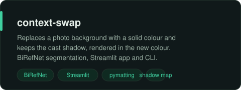
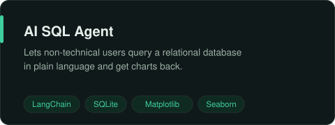
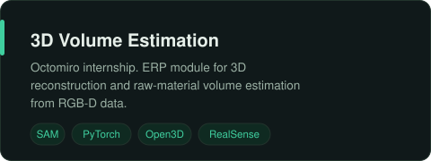

  

  

  
  

## About me

I build intelligent systems: agents that use language models, pipelines that feed them, and computer vision that works on real data. I like projects where the model has to survive contact with a real problem, with tests, guardrails and clear documentation around it.

- **Now:** final-year Software Engineering student at **ISI**, looking for an **end-of-studies internship (PFE)**.
- **Summer 2026:** Research intern at **MARS Laboratory**, using Machine Learning to speed up security estimation for post-quantum cryptography (manuscript in preparation).
- **Summer 2025:** Software &amp; AI Engineering intern at **Octomiro**. I worked on 3D reconstruction and volume estimation from RGB-D data, and on padel shot recognition.
- **Sept 2025:** Participant in the **BILD Summer School** on AI and Medical Imaging, University of Bonn (SANAD &amp; DAAD).
- **Community:** Events coordinator and moderator at **PyData Tunisia**.
- **Interests:** LLM applications, RAG, AI agents and multi-agent systems, computer vision, DevOps.

## Tech stack

  <b>LANGUAGES</b> 
    
  <b>AI &amp; MACHINE LEARNING</b> 
   
  
  
  
  
  
  
  
    
  <b>PYTHON LIBRARIES</b> 
   
  
  
  
  
    
  <b>BACKEND</b> 
    
  <b>FRONTEND &amp; MOBILE</b> 
    
  <b>DATA</b> 
    
  <b>DEVOPS &amp; TOOLS</b> 
  

## Featured projects

Most recent first. Cards with a link open the repository.

  
  
  
  
  
  

## Certifications

<svg xmlns="http://www.w3.org/2000/svg" viewBox="0 0 992 144" width="992" height="144" role="img" aria-label="Certifications">
<g font-family="'Segoe UI',Helvetica,Arial,sans-serif">
<rect x=".5" y=".5" width="319" height="63" rx="12" fill="#10191A" stroke="#22332C"/>
<circle cx="26" cy="32" r="11" fill="#0F2A21" stroke="#3FCF9F"/>
<path d="M21 32l4 4 7-8" fill="none" stroke="#3FCF9F" stroke-width="2" stroke-linecap="round" stroke-linejoin="round"/>
<text x="48" y="29" font-size="14.5" font-weight="600" fill="#E6EFE9">Azure AI Fundamentals</text>
<text x="48" y="48" font-size="12.5" fill="#3FCF9F">Microsoft</text>

<rect x="336.5" y=".5" width="319" height="63" rx="12" fill="#10191A" stroke="#22332C"/>
<circle cx="362" cy="32" r="11" fill="#0F2A21" stroke="#3FCF9F"/>
<path d="M357 32l4 4 7-8" fill="none" stroke="#3FCF9F" stroke-width="2" stroke-linecap="round" stroke-linejoin="round"/>
<text x="384" y="29" font-size="14.5" font-weight="600" fill="#E6EFE9">Fundamentals of Agents</text>
<text x="384" y="48" font-size="12.5" fill="#3FCF9F">Hugging Face</text>

<rect x="672.5" y=".5" width="319" height="63" rx="12" fill="#10191A" stroke="#22332C"/>
<circle cx="698" cy="32" r="11" fill="#0F2A21" stroke="#3FCF9F"/>
<path d="M693 32l4 4 7-8" fill="none" stroke="#3FCF9F" stroke-width="2" stroke-linecap="round" stroke-linejoin="round"/>
<text x="720" y="29" font-size="13.5" font-weight="600" fill="#E6EFE9">Getting Started with Deep Learning</text>
<text x="720" y="48" font-size="12.5" fill="#3FCF9F">NVIDIA</text>

<rect x=".5" y="80.5" width="319" height="63" rx="12" fill="#10191A" stroke="#22332C"/>
<circle cx="26" cy="112" r="11" fill="#0F2A21" stroke="#3FCF9F"/>
<path d="M21 112l4 4 7-8" fill="none" stroke="#3FCF9F" stroke-width="2" stroke-linecap="round" stroke-linejoin="round"/>
<text x="48" y="109" font-size="14.5" font-weight="600" fill="#E6EFE9">Data Analytics Essentials</text>
<text x="48" y="128" font-size="12.5" fill="#3FCF9F">Cisco</text>

<rect x="336.5" y="80.5" width="319" height="63" rx="12" fill="#10191A" stroke="#22332C"/>
<circle cx="362" cy="112" r="11" fill="#0F2A21" stroke="#3FCF9F"/>
<path d="M357 112l4 4 7-8" fill="none" stroke="#3FCF9F" stroke-width="2" stroke-linecap="round" stroke-linejoin="round"/>
<text x="384" y="109" font-size="14.5" font-weight="600" fill="#E6EFE9">Python for Data Science</text>
<text x="384" y="128" font-size="12.5" fill="#3FCF9F">CDOSS</text>

<rect x="672.5" y="80.5" width="319" height="63" rx="12" fill="#10191A" stroke="#22332C"/>
<circle cx="698" cy="112" r="11" fill="#0F2A21" stroke="#3FCF9F"/>
<path d="M693 112l4 4 7-8" fill="none" stroke="#3FCF9F" stroke-width="2" stroke-linecap="round" stroke-linejoin="round"/>
<text x="720" y="109" font-size="14.5" font-weight="600" fill="#E6EFE9">AI and ML Fundamentals</text>
<text x="720" y="128" font-size="12.5" fill="#3FCF9F">CDOSS</text>
</g>
</svg>

  

