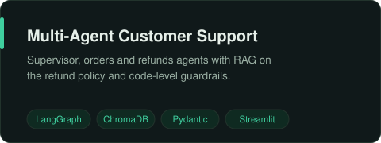
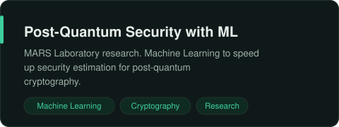
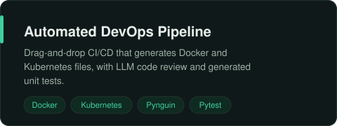
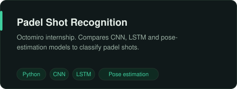
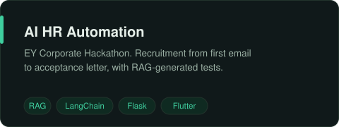
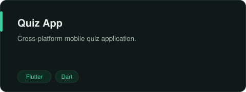
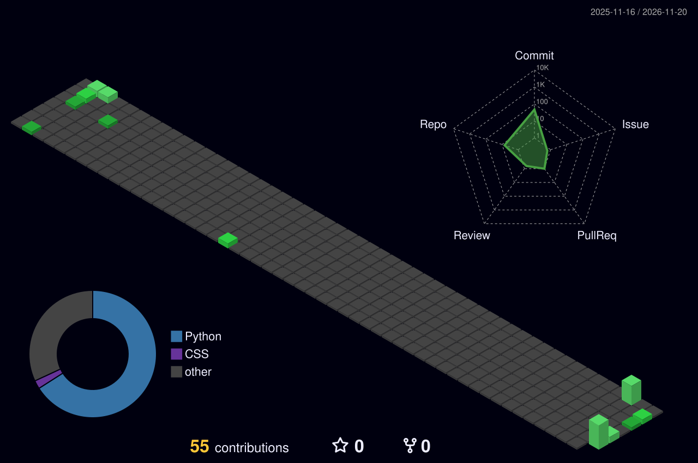

  

  

  
  
  

## About me

I build intelligent systems: agents that use language models, pipelines that feed them, and computer vision that works on real data. I like projects where the model has to survive contact with a real problem, with tests, guardrails and clear documentation around it.

- **Now:** final-year Software Engineering student at **ISI**, looking for an **end-of-studies internship (PFE)**.
- **Summer 2026:** Research intern at **MARS Laboratory**, using Machine Learning to speed up security estimation for post-quantum cryptography (manuscript in preparation).
- **Summer 2025:** Software &amp; AI Engineering intern at **Octomiro**. I worked on 3D reconstruction and volume estimation from RGB-D data, and on padel shot recognition.
- **Sept 2025:** Participant in the **BILD Summer School** on AI and Medical Imaging, University of Bonn (SANAD &amp; DAAD).
- **Community:** Events coordinator and moderator at **PyData Tunisia**.
- **Interests:** LLM applications, RAG, AI agents and multi-agent systems, computer vision, DevOps.

## Tech stack

  <b>LANGUAGES</b> 
    
  <b>AI &amp; MACHINE LEARNING</b> 
   
  
  
  
  
  
    
  <b>BACKEND</b> 
    
  <b>FRONTEND &amp; MOBILE</b> 
    
  <b>DATA</b> 
    
  <b>DEVOPS &amp; TOOLS</b> 
  

## Featured projects

Most recent first. Cards with a link open the repository.

  
  
  
  
  
  
  
  

**Also on GitHub:** [sys-expert-ai](https://github.com/imenmiladi/sys-expert-ai) · [context-swap](https://github.com/imenmiladi/context-swap)

## Certifications

Azure AI Fundamentals (Microsoft) · Fundamentals of Agents (Hugging Face) · Getting Started with Deep Learning (NVIDIA) · Data Analytics Essentials (Cisco) · Python for Data Science and AI and ML Fundamentals (CDOSS)

## Contributions

  

  

  
  

  

  

